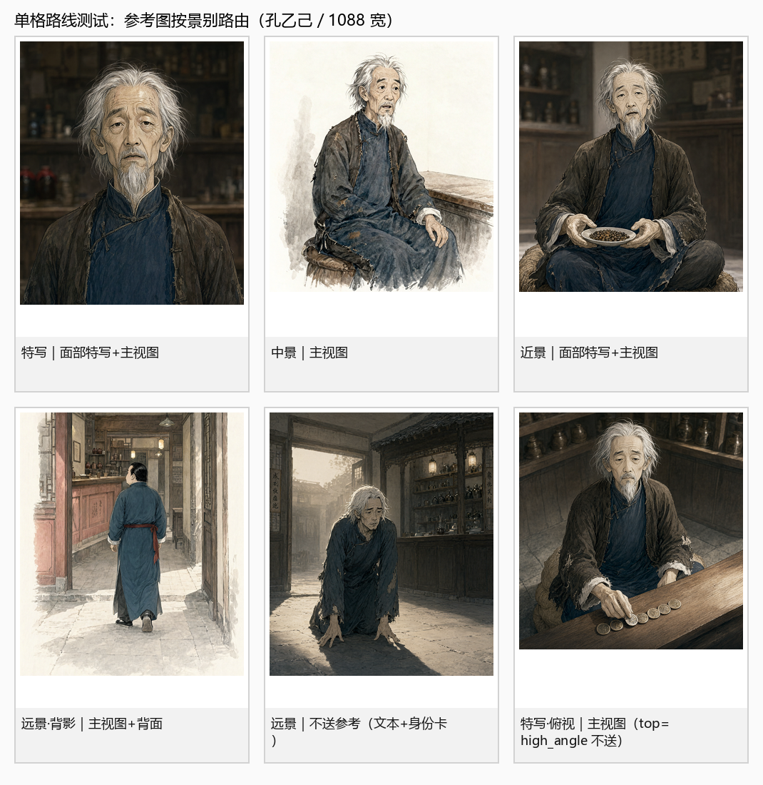
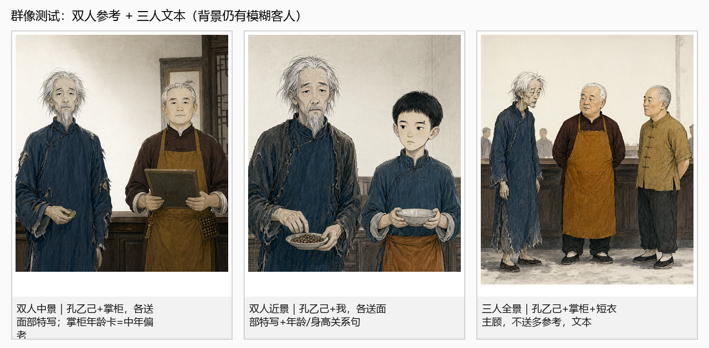
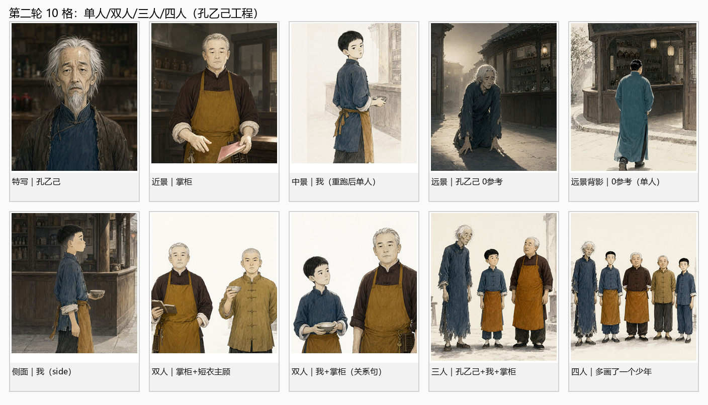
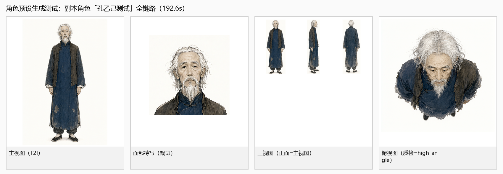

# 06 落地实现与测试记录（2026-11-03）

> 本文记录：**按 `角色分镜一致性资料` 的方案改了什么、怎么测的、结果如何、还剩什么问题。**
> 环境：RTX 4070 Laptop 8GB / ComfyUI / Qwen-Image-2.1 Turbo int8 / 2026-11-03。
> 测试范围：**角色预设资产 + 分镜单格 + 双人/三人/四人群像**，不跑完整小说流程。

---

## 0. 结论

1. **P0 已修复**：Qwen 参考图从“静默丢弃”变成真正进入模型；同一提示词/种子换参考图，输出会变化。
2. **参考图路由已落地**：特写/近景送面部特写+主视图；中景送主视图；侧/背送单视图；顶视只在 `top_down` 时送；全景/远景默认 0 张；双人每人一张面部特写；3 人 0 张，4 人建议拆 3+1/2+2。
3. **单格一致性明显改善**：孔乙己的特写/中景/近景/背影 4 格，发型、胡子、蓝衫+深褐夹克、瘦长脸稳定；输出画幅全部等于分镜格（1088×1280/1216/1152）。
4. **双人群像可用**：孔乙己+掌柜、孔乙己+我、掌柜+短衣主顾、我+掌柜都人物可区分、无第三人；少年“我”需要通过“年龄/身高关系句”+年龄卡才不被画成成年人。
5. **三人是 Qwen 群像甜点**：孔乙己+我+掌柜在“空荡酒店”描述下三人干净、年龄/身高正确；写“咸亨酒店”时更容易补背景客人。
6. **四人同框会多画一个**：4 人输出 5 人（多一个少年），**按 3 人上限用**。
7. **自检通过**：`selftest.py` 全部通过；角色预设副本全链路（姿态图→主视图→三视图→俯视图→面部特写/单视图）成功，192.6s。
8. **第 4–7 步同源**：分镜拆解上限 3 人；25 格改用同一套参考路由；Qwen T2I 下 25 格/姿态图不再挂自动骨架；最终出图继续用 `build_shot_prompt() + plan_shot_refs()`。









---

## 1. 代码改动

| 文件 | 改动 | 目的 |
|---|---|---|
| `comicgen/qwenedit.py` | `images` 改扁平键 `images.image_N`；参考图 pad 到目标画幅；输出 `ImageOps.fit` 到分镜格；`generate_control` 同步 | 修 P0；保证参考图生效；保证画幅 |
| `comicgen/qwencomic.py` | 有参考图时把 `size` 元组传给 Edit/Control，不再 `max(size)` | 保留分镜格比例 |
| `config.py` | 新增 `QWEN_STORYBOARD_WIDE_USE_REF`、`QWEN_STORYBOARD_FACE_REF`、`QWEN_REFERENCE_PAD_TO_PANEL`、`CHARACTER_FACE_FILENAME`、`CHARACTER_VIEW_DIR/SIZE` | 路由/资产开关 |
| `comicgen/models.py` | `Character.face_ref/views/view_quality`；`Shot.view_hint/ref_plan`；`face_reference()/view()/view_quality_of()` | 存资产与路由计划 |
| `comicgen/charrefs.py` | **新增**：面部特写裁切、三视图切单视图、俯视质量（人脸检测）、资产刷新 | 派生分镜要用的参考图 |
| `comicgen/pipeline.py` | `refresh_character_assets()`；`plan_shot_refs()`；`build_shot_prompt` 接入 `ref_roles`；特写/近景清自动骨架；`style_reference` 识别 Qwen 客户端；多脸检测/换 seed 重跑一次 | 路由与资产生成；人数兜底 |
| `comicgen/prompts.py` | `ref_roles` 角色化说明；`_normalize_age()`；`_cast_relation_text()` 写入画面内容 | 参考图职责；年龄/身高关系 |
| `comicgen/castguard.py` | `compact_card()` 增加年龄字段；`_age_anchor()` 从 age/人设补年龄带 | 双人卡不再丢年龄 |
| `comicgen/poseutil.py` | `cv2.imread/imwrite` 换成 PIL + numpy 的 Unicode 安全读写 | 中文路径下俯视参考可读 |
| `server.py` | 25 格改用 `build_shot_references()`；Qwen T2I 跳过前置姿态、不传自动骨架；4 人关键镜头拦截；阶段 6 在 T2I 下返回“自动姿态停用” | 第 4–7 步同一套路由 |
| `selftest.py` | 修正“打开”姿态断言；4 人改为“群像 3 人保留、4 人拆” | 与新人数政策一致 |

### 1.1 P0 修复

修复前（嵌套，ComfyUI 不识别动态槽位）：

```python
images = {f"image_{i+1}": [str(20 + i), 0] for i in range(len(names))}
graph["5"] = {"class_type": "TextEncodeQwenImage21", "inputs": {
    ..., "images": images, ...}}
```

修复后（扁平键）：

```python
enc = {"clip": ["2", 0], "prompt": prompt, "negative_prompt": negative,
       "resolution": resolution, "vae": ["3", 0]}
for i in range(len(names)):
    enc[f"images.image_{i+1}"] = [str(20 + i), 0]
```

证据：

- 修复前：主视图 / +三视图 / +俯视图 / 三张全送，四张输出 SHA256 完全相同；换红块参考仍相同。
- 修复后：同一提示词/种子，主视图参考输出哈希变化，画面明显贴近主视图。
- 复现：`tools/ref_probe.py`（旧路径，预期失败）与 `tools/ref_probe_flat.py`（扁平键，预期生效）。

### 1.2 画幅处理

- Qwen 输出 latent 跟随第 1 张参考图比例；
- 现在送图前把参考图 **等比缩到目标画幅内并白底居中**（不放大、不裁人物）；
- pad 缓存名带 **源路径 hash**：不同角色都有 `主视图.png` / `面部特写.png`，不带 hash 会让第二个角色命中第一个角色的 pad 图，造成串脸；
- 出图后再 `ImageOps.fit` 到分镜格，保证 1088×1280/1216/1152 等尺寸；
- 实测 9 格全部返回目标尺寸，没有出现“参考图 2:3 把分镜格拉成 832×1248”的问题。

### 1.3 路由实现

`plan_shot_refs()` 的实际规则（Qwen 分镜、单人）：

| 场景 | 送图 |
|---|---|
| 特写/近景（正面） | 面部特写 → 主视图（2 张） |
| 中景（正面） | 主视图（1 张） |
| 全景/远景（正面） | 默认 0 张（`WIDE_USE_REF=False`） |
| 侧面 | 主视图 → `views/side.png` |
| 背面 | 主视图 → `views/back.png` |
| 正顶视 | 主视图 → `views/top.png`，仅当 `view_quality=top_down` |
| 双人中/近景 | 每人一张面部特写（2 张） |
| 双人全景 | 0 张（优先拆正反打） |
| 3 人 | 0 张（文本+关系句；群像图可选） |

---

## 2. 角色资产

对 `孔乙己·全文测试` 工程的 8 个角色刷新了资产：

| 角色 | 面部特写 | 单视图 | 俯视质量 |
|---|---|---|---|
| 孔乙己 | ✅ | front/side/back/top | **high_angle**（能看到脸） |
| 掌柜 | ✅ | front/side/back/top | **high_angle** |
| 我 | ✅ | front/side/back/top | **top_down** |
| 丁举人 | ✅ | front/side/back/top | **top_down** |
| 短衣主顾 | ✅ | front/side/back | 无俯视 |
| 邻舍孩子 | ✅ | front/side/back | 无俯视 |
| 长衫主顾 | ✅ | front/side/back | 无俯视 |
| 喝酒的人 | ❌（主视图未检出脸） | front/side/back | 无俯视 |

> “喝酒的人”是群众角色，Haar 漏检时自动回退“主视图顶部居中头肩框”，仍会生成面部特写；不阻断。

角色预设副本 `孔乙己测试` 全链路：

```text
姿态图 1536×1536（ControlNet，无参考图）
  → 主视图 1024×1536（T2I）
  → 三视图（正面=主视图，侧面/背面 Qwen Edit）
  → 俯视图（参考骨架提取失败 → 文本顶视；质检=high_angle）
  → 面部特写（512×512，从主视图裁）
  → views/front|side|back|top
```

耗时 192.6s；主视图/三视图/面部特写都能对上；俯视图仍是“能看到脸的高角度”，质检正确标成 `high_angle`，没有冒充 `top_down`。

---

## 3. 分镜单格测试

| # | 镜头 | 角色 | 参考图计划 | 尺寸 | 耗时 | 观察 |
|---|---|---|---|---|---|---|
| 1 | 特写 | 孔乙己 | face + main | 1088×1280 | 92.1s | 脸/胡子/蓝衫稳定；背景没有明显路人 |
| 2 | 中景 | 孔乙己 | main | 1088×1216 | 86.7s | 全身比例、蒲包、蓝衫稳定 |
| 3 | 近景 | 孔乙己 | face + main | 1088×1216 | 83.5s | 脸部稳定；手/碟子略偏 |
| 4 | 远景·背影 | 长衫主顾 | main + back | 1088×1280 | 95.6s | 背身结构、石青长衫、红丝绦一致；无正脸 |
| 5 | 远景 | 孔乙己 | 0 张（文本） | 1088×1280 | 29.1s | 无参考也能认出角色；无克隆人 |
| 6 | 特写·俯视 | 孔乙己 | main（top=high_angle 不送） | 1088×1152 | 50.9s | 高角度手部特写成立；没有把 high_angle 当顶视 |

**关键结论：**

- 特写/近景用 `face + main`，脸明显比只送主视图更稳；主视图仍负责领口/服装。
- 侧/背镜头用 `main + side/back`，背身没有出现正脸，身体/服装与主视图一致。
- 远景 0 参考没有崩，说明“远景靠文本+身份卡”在当前画风下可用；但脸只占很小，不追求特写级一致。
- 顶视 `high_angle` 被正确跳过，避免把“高角度”当“正上方顶视”用。
- **补充回归：** 中景 + 自动姿态骨架（`pose_07`）+ 主视图，79.1s，`generate_control()` 没有 shape/batch 报错；人物坐下、身份/服装稳定。说明“ControlNet + 参考图”可以同时用，但特写/近景仍应清掉自动骨架。

### 3.1 第 5 步 25 格单格抽测

- 第 5 步已改用 `build_shot_references()`，与第 7 步共用同一套路由；
- 抽测“我”的中景 25 格单格：`main` 1 张、512×512、29.2s、`qwen_image_2.1_turbo_edit_local`，画面是单人少年，没有因为 25 格走旧 `character_reference_bundle()` 而绕过 T2I 策略；
- Qwen T2I 下 25 格不再先补自动姿态，也不把 `pose_skeleton` 传给 25 格；需要动作锁定时用自定义姿态；
- 25 格入口对 >3 人的关键镜头直接报错提示先拆，`force=true` 才允许硬出。

---

## 4. 群像测试

| # | 镜头 | 角色 | 参考图 | 尺寸 | 耗时 | 观察 |
|---|---|---|---|---|---|---|
| 7 | 双人中景 | 孔乙己 + 掌柜 | face ×2 | 1088×1216 | 87.1s | 两人清晰可分；掌柜按“中年偏老”卡+新预设，年龄/体型不再被画成青年；无第三人 |
| 8 | 双人近景 | 孔乙己 + 我 | face ×2 + 关系句 | 1088×1216 | 84.0s | “我”是少年，身高只到孔乙己胸口；脸/服装可区分 |
| 9 | 三人全景 | 孔乙己 + 掌柜 + 短衣主顾 | 0 张（文本） | 1088×1280 | 24.6s | 三人排布/服装/角色可区分；掌柜/短衣主顾年龄卡生效；背景仍有模糊客人 |

### 4.1 “我”的年龄漂移与修复

- 初版：`我` 的面部特写是十二岁少年，但双人格输出是二十岁左右青年。
- 根因有三层：
  1. `Character.age = "十二岁起当伙计，叙述时已成年"`，身份卡截成“十二岁起当伙计”，模型读成“当过伙计的成年人”；
  2. `castguard.compact_card()` 的字段里**没有年龄**，双人卡只写性别/脸/发/眼/服装/记忆点；即使把 age 改成“中年偏老”，prompt 里也不会出现；
  3. 双人场景的年龄/身高关系没有写进画面内容，模型按“伙计=成年人”的先验画。
- 修复：
  1. `_normalize_age()` 把“十二岁起当伙计，叙述时已成年”压成“十二岁”；age 为“未知”时只从人设补“少年/中年偏老/中年”等年龄带，不补数字年龄；
  2. `castguard.compact_card()` 增加“年龄”字段，并参与卡片（不参与“先丢”的字段）；
  3. `_cast_relation_text()` 在“画面内容”里补“我是十二岁，孔乙己是成年人，我比孔乙己小得多；孔乙己比我高出一头，我只到孔乙己胸口”；
  4. 用带“年龄：中年偏老”的卡重新生成了掌柜预设（主视图/三视图/面部特写），再回测双人格。
- 结果：
  - 双人格里的“我”从青年变成少年，身高关系成立；
  - 掌柜从“银发青年”回到“中年偏老、矮壮”的预设，双人卡年龄生效。
- 但仍不是严格 12 岁儿童脸，属于“可识别为同一少年”的水平；要更严格需要 LoRA/换脸或专门的儿童体型参考。

> 结论：**年龄既要进 `compact_card`，也要进“画面内容”的关系句；预设本身也要按年龄带重生成，否则会“一致地错”。**

### 4.2 第二轮 10 格（cstestg02）

| # | 镜头 | 角色 | 计划 | 尺寸 | 耗时 | 观察 |
|---|---|---|---|---|---|---|
| 1 | 特写 | 孔乙己 | face+main | 1088×1280 | 101.9s | 脸/服装稳定，背景干净 |
| 2 | 近景 | 掌柜 | face+main | 1088×1216 | 85.5s | 新预设（中年偏老）生效 |
| 3 | 中景 | 我 | main | 1088×1216 | 50.9s | 首版多画一个少年，重跑后单人；Haar 没检出错位侧脸 |
| 4 | 远景 | 孔乙己 | 0 张 | 1088×1280 | 27.5s | 无参考、单人 |
| 5 | 远景·背影 | 长衫主顾 | 首版 main+back | 1088×1280 | 35.6s（改 0 张后） | **首版复制成两个人**；改 0 张后单人 |
| 6 | 中景·侧面 | 我 | main+side | 1088×1216 | 90.0s | 侧脸/少年体型正确，单人 |
| 7 | 双人中景 | 掌柜+短衣主顾 | face×2 | 1088×1216 | 90.2s | 两个中年人清晰可分、无第三人 |
| 8 | 双人近景 | 我+掌柜 | face×2 | 1088×1216 | 123.6s | 少年+中年，身高差成立 |
| 9 | 三人全景 | 孔乙己+我+掌柜 | 0 张 | 1088×1280 | 90.1s | **三人干净、年龄/身高正确、无第四人** |
| 10 | 四人全景 | 孔乙己+掌柜+短衣+我 | 0 张 | 1088×1280 | 85.3s | **多画了一个少年（5 人）** |


**第二轮得出的优化：**

1. **全景/远景默认 0 参考**：首版 `main+back` 把背影复制成两个人；改成 0 张后单人。`plan_shot_refs()` 已在 wide 分支提前返回 `[]`。
2. **3 人是 Qwen 群的甜点**：三人（空荡场景描述）干净、年龄/身高正确；4 人必多画一个（尤其有儿童/少年时），建议拆成 3+1 或 2+2。
3. **多脸重试只能兜底**：`IMAGE_DUPLICATE_CHECK` 用 Haar 数脸，侧脸/小脸会漏检；本次 4 人 5 脸没触发重试。它只能减少明显双脸，不能保证人数。
4. **场景词决定背景**：三人格写“空荡的酒店”时背景干净；写“咸亨酒店”时更容易补模糊客人。背景控制优先改场景描述/空背景板，不要靠负向词。

---

## 5. 仍然存在的问题

### 5.1 背景会补模糊客人

- ctestg02 三人格写“空荡的酒店/空无一人的柜台”时背景干净；ctestg01 三人格写“咸亨酒店”时出现模糊客人；
- 提示词已写“空无一人的咸亨酒店”“画面里只有 N 位人物”，但 Qwen 仍会按“酒馆”先验补人；
- 负向词在 `cfg=1.0` 下基本不生效，不能靠“不要路人”解决。

**建议：**

1. 场景描述改成更具体的“空柜台 + 酒坛 + 粉板”，避免“酒馆/客人”语境；
2. 对必须干净的单人格/群像，出图后按主脸/主体做一次裁切，或用背景板/局部重绘；
3. 三人以上建立镜头接受“背景环境人物”，只保证主叙事角色。

### 5.2 三人以上：3 张参考的 A/B 结果（不采纳）

- 当前 3 人按方案 0 张多参考，靠文本+关系句；4 人拆 3+1/2+2；结构成立，但脸/年龄与单人格预设会有差距；
- 2026-11-03 补做了一次三人格 A/B：**3 人各送一张面部特写（3 张）vs 文本+关系句**。
- 结果：3 参考版三人站成一排、姿势僵硬，掌柜/短衣主顾的体型从“矮壮敦实”变瘦，脸也与预设偏差更大；背景仍补模糊客人。文本版的身体/服装/构图更自然。
- 结论：**Qwen 2.1 Turbo 上 3 人 3 参考不划算**；3 人继续 0 张多参考，4 人建议拆 3+1 或 2+2。
- 对比图：`data/shots/ctestg01/分镜_009_3refs.png` vs `分镜_009_textonly.png`。

### 5.6 四人同框会多画一个

- ctestg02 第 10 格四人（孔乙己+掌柜+短衣主顾+我）输出 **5 人**，多画了一个少年；
- 原因：四人横列 + 两个少年/老年/中年混排，模型在“最右少年”旁又补了一个同款少年；Haar 没检足 5 张脸（漏检），多脸重试没触发；
- 结论：**Qwen 2.1 Turbo 的群像上限按 3 人用**；4 人必须拆成 3+1 或 2+2，或人工修掉多余人物。
- 提示词长度：四人 1128 字，已超过 1000 基础预算（4 人放宽到 1120），再叠关系句会超。

### 5.3 俯视图仍不是真顶视

- 孔乙己/掌柜/测试角色的俯视图仍是 45° 高角度，质检 `high_angle` 正确；
- `poseutil.photo_to_skeleton` 已修 Unicode 路径，但 MediaPipe 对“只有头顶”的俯视参考检测不到人体，自动回退文本顶视；
- 真顶视需要真实俯拍/3D 渲染，或换支持顶视的编辑模型。

### 5.4 用户自定义姿态仍会进特写

- 本次测试清空了 `pose_image/pose_skeleton`；
- 生产代码只清“自动骨架”，用户显式上传的姿态仍保留（尊重用户意图）；
- 如果用户上传的是全身骨架，特写仍可能被体型先验污染；建议界面提示“特写不要挂全身骨架”，或在特写时把用户骨架降级为半身。

### 5.5 提示词长度接近上限

- 双人格提示词约 975–999 字；三人约 1079 字（3 人预算 1080）；
- 再加参考图职责/关系句容易超预算；需要继续压缩身份卡或把关系句做成短句。

---

## 6. 复现命令

```powershell
# 1) 参考图路由探针（旧路径应哈希相同；扁平键应不同）
env\Scripts\python.exe tools\ref_probe.py
env\Scripts\python.exe tools\ref_probe_flat.py

# 2) 角色预设副本全链路（约 3 分钟）
env\Scripts\python.exe tools\preset_test.py

# 3) 单格 + 群像一致性测试（约 10 分钟）
env\Scripts\python.exe tools\consistency_test.py

# 4) 离线自检
env\Scripts\python.exe selftest.py
```

产物：

- 工程：`data/projects/ctestg01.json`、`data/projects/ctestg02.json`、`data/projects/ctestpre1.json`
- 分镜：`data/shots/ctestg01/分镜_001…009_raw.png`、`data/shots/ctestg02/分镜_001…010_raw.png`
- 预设副本：`data/characters/孔乙己测试/默认造型/`
- 汇总：`outputs/consistency_test/summary.json`、`outputs/consistency_test2/summary.json`
- 对比图：`角色分镜一致性资料/assets/04_单格路线测试.png`、`05_群像测试.png`、`06_预设生成测试.png`、`07_第二轮一致性测试.png`

---

## 7. 下一步建议

1. **3 人 3 参考 A/B**：同一三人格，文本 vs 3 张面部特写，比较身份/服装/人数/串脸；决定是否放宽 3 人路由。
2. **背景人数控制**：为空镜/单人场景准备“空柜台/空街道”背景板，或用局部重绘去掉背景路人。
3. **ArcFace 量化**：给 9 格 + 3 角色预设算同角色/跨角色相似度，标定项目内阈值，替代“肉眼可辨”。
4. **真顶视**：用真实俯拍/3D 渲染参考，或换 2511/多视角编辑模型；`high_angle` 继续只当高角度用。
5. **文档同步**：04/03 已更新为“已修复/已落地”；`rules/08`、`rules/09`、`docs/角色主视图与姿态图.md` 已加 2026-11-03 更新注，正文仍待逐步重写。

> 本次测试证明：**“参考图路由 + 一图一职 + 年龄/身高关系句”在 8GB Qwen 2.1 上是可以落地的**；最大的剩余问题不是“脸不像”，而是“背景补人”和“三人以上没有参考”。
