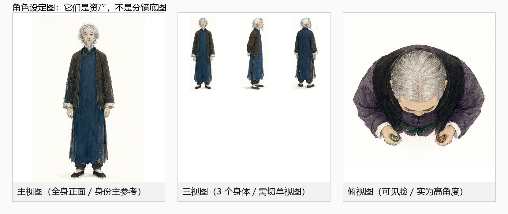
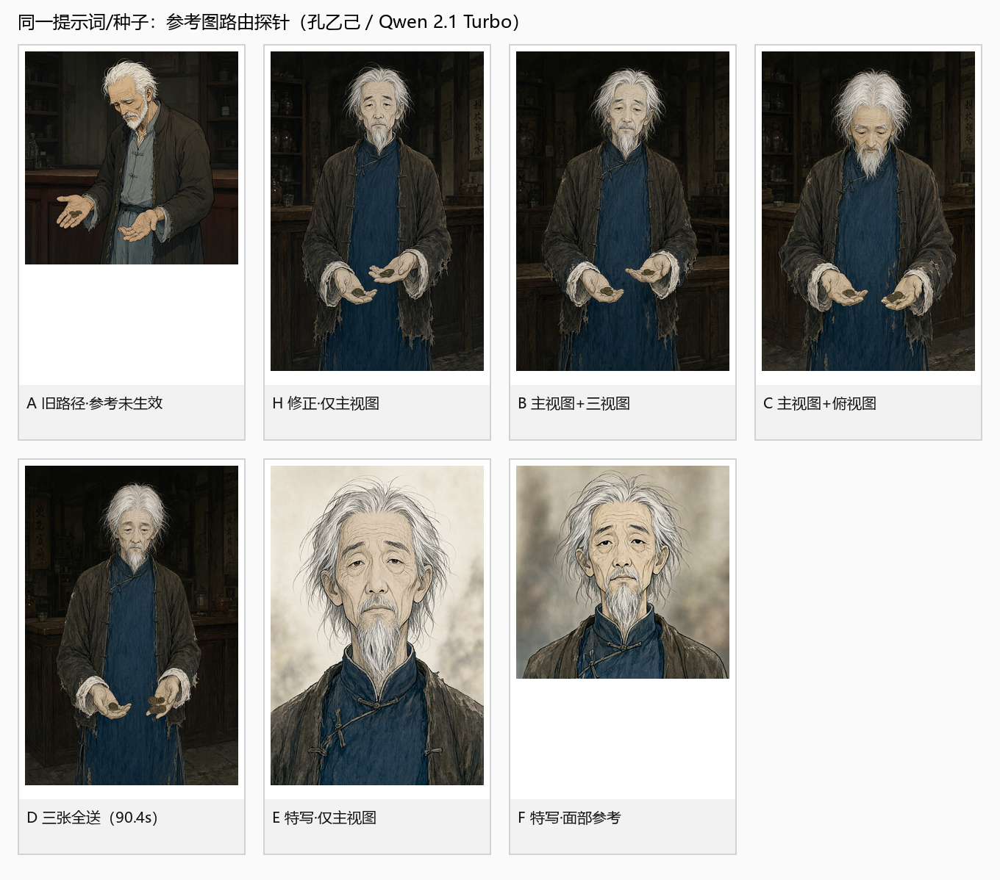
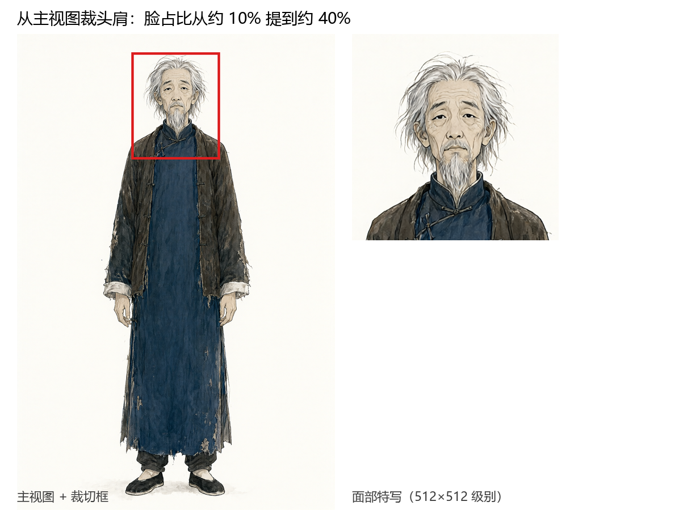
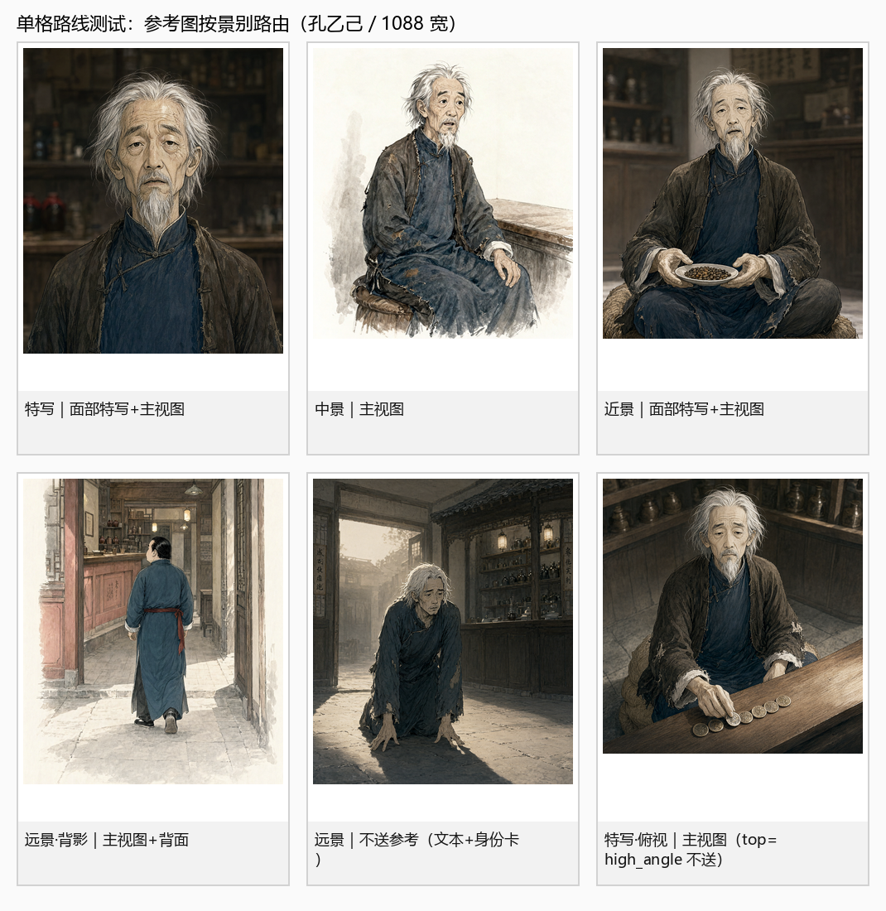
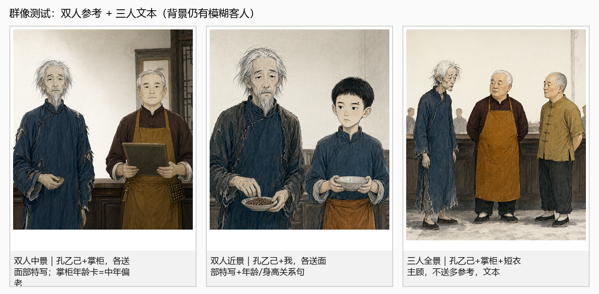
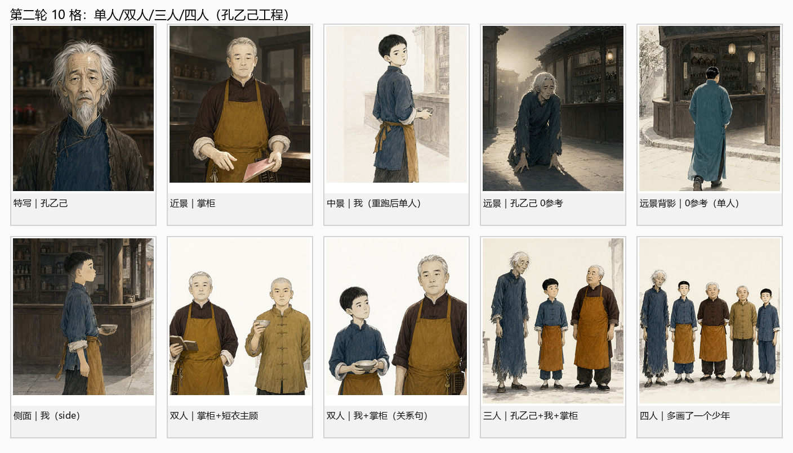

# 角色分镜一致性资料

> 主题：从角色**主视图 / 三视图 / 俯视图**，到**多格分镜图**的参考图体系
> 版本：2026-11-03
> 状态：**已落地并测试**——P0（Qwen 参考图未生效）已修复；面部特写/单视图资产、按景别路由、年龄/身高关系句已实现。测试记录见 [`06_落地实现与测试记录.md`](06_落地实现与测试记录.md)。
> 适用：本项目当前环境（RTX 4070 Laptop 8GB / ComfyUI / Qwen-Image-2.1 Turbo int8 / Z-Image-Turbo）
> 结论先行：**设定图是角色的“身份证”，不是分镜的“底图”。多分镜一致性不靠“多送几张图”，而靠“每格只送一张、只承担一个职责的图”，再叠加文本、构图控制、拆格与验收。**

---

## 0. 一句话回答

> **主视图锁“是谁”，面部特写锁“脸”，单张侧/背/顶视图锁“这一镜看到的角度”，骨架锁“动作”，文本锁“这一格在演什么”，人数控制与拆格锁“画面里有几个人”。**
>
> 把这六件事分开，人物就稳；让一张三视图同时干六件事，人物必崩。

### 先看三张图

- 图 1：主视图是全身像，脸只占约 10%；三视图是 3 个身体；俯视图实际能看到脸，不是真顶视。
- 图 2：同一提示词/种子下的路由探针。A 是旧路径（参考图未生效，画面是“通用老人”）；H 修复格式后（白发、瘦长脸、蓝衫+深褐夹克，明显贴近主视图）；B/C/D 加了三视图/俯视图，仍是单人，但耗时从 39.9s 增到 60.2/63.9/90.4s，没有可见收益。
- 图 3：从主视图裁头肩，把脸占比从约 10% 提到约 40%；这是“面部特写”资产的最低成本做法。

### 落地测试（2026-11-03）

- 单格：特写/中景/近景/背影/远景/俯视 6 格，参考图按景别路由，脸/发型/服装稳定，输出画幅全部等于分镜格。
- 双人：孔乙己+掌柜、孔乙己+我，各送一张面部特写；两人可区分、无第三人；少年“我”需要“年龄/身高关系句”才不被画成成年人。
- 三人：孔乙己+掌柜+短衣主顾，不送多参考；三人排布/服装可区分，背景是否补人取决于场景词。
- 四人：实测会多画一个（5 人）；**按 3 人上限用**，4 人拆 3+1/2+2。

---

## 1. 我的判断（五条）

### 判断一：整张三视图 / 姿态总图不能直接进分镜

一张图里有三个（甚至十几个）身体。对编辑类模型（Qwen Image Edit）来说，参考图不是“身份数据库”，而是**要被理解并延续的画面内容**。送一张三联图，等于告诉模型“这一格可以出现多个同一角色”；轻则拼贴感，重则直接复制成两三个人。

这不是理论推演，是本项目已经踩过的坑：

- `docs/角色主视图与姿态图.md` 记录过“三视图的三个小人进入分镜参考后，模型会抄成多人构图”；
- `comicgen/pipeline.py:3001` 的 `character_reference_bundle()` 因此明确写着“三视图/俯视图也不送”；
- `docs/测试2_自测报告.md` 第 23、27 节记录了双人/多人格被模型自行补人的连续失败。

**需要补一句实测边界：** 本次用一个单例探针（同一提示词/种子，孔乙己，Qwen-Image-2.1 Turbo）把“主视图 / +三视图 / +俯视图 / 三张全送”跑了一遍，**没有复现“直接变多人”**——四张都还是单人。但代价是：生成时间从 39.9s 增到 60.2s / 63.9s / 90.4s（最多 2.26 倍），画面没有可见收益，而且三视图/俯视图的“多身体版式”风险仍然存在（换模型、换提示词、换景别就可能触发）。所以结论不变，但理由要写准确：

> **不是“整张三视图必然变多人”，而是“整张三视图高风险、无收益、不可控，且成本显著更高”。**
>
> 工程上仍然选择“切成单视图、按镜头送一张”，不是因为“必炸”，而是因为**这是唯一能同时控制风险、成本和视角正确性的做法**。

**结论：三视图是“资产”，不是“条件”。进分镜前必须切成单张单视图。**

### 判断二：主视图是“身份主参考”，但不是万能参考

主视图是全身正面像，脸只占画面很小一部分。本次对项目内 20 个角色主视图做了实测（Haar 人脸检测）：

| 指标 | 结果 |
|---|---|
| 主视图尺寸 | 1024×1536 |
| 能检出人脸的角色 | 17 / 20 |
| 人脸高度中位数 | **160 px**（约占画面高度 **10.4%**） |
| 人脸高度范围 | 100–305 px（6.5%–19.9%） |

一张 1088×1280 的分镜格，如果脸占画面高度 60%，脸在成图里约 **768 px**；而参考图里的脸只有 **160 px**。模型不是“把 160px 的脸贴上去”，而是**用 160px 的信息去重新合成 768px 的脸**——细节只能猜。特写越近，猜得越多。

**结论：特写/近景需要独立的“面部特写”参考；只送全身主视图，等于让模型用 1/5 的分辨率猜脸。**

### 判断三：三视图的价值在“视角字典”，不在“一张拼图”

三视图真正有用的信息是：**侧面轮廓**（鼻梁高度、下颌角、后脑形状）和**背面结构**（后发、衣领、背部服装）。这些信息主视图没有，正面参考也猜不准。

但“三张并排”不是唯一形态，更不是最佳送法：

- 三联图整张送：每张可检出人脸只剩约 **87 px**（本次实测中位；侧/背脸常检不出，实际更小），还会诱导拼贴；
- 切成单张送：侧身镜头只送侧面、背身镜头只送背面，脸在参考图中的占比从约 1/9 提到约 1/3，编码器会把更多 token 分给它；同时不会带进另外两个身体。

**结论：三视图落库时就切成 `front / side / back` 三张单视图（有左右两张侧面时可再分 `side_l / side_r`）；分镜按镜头视角选一张，永远不送整张。**

### 判断四：俯视图是“几何参考”，不是“身份参考”

俯视图看不到脸，锁不了身份；它能提供的是**发旋、发缝、发髻/马尾在头顶的形状、肩线与衣领的俯视结构**。所以：

- 只有真正的顶视/高角度镜头才需要它；
- 它必须和主视图一起送（主视图锁身份，俯视图锁角度），不能单独送；
- 它不是“必须项”：没有合格俯视图时，宁可不拍这个机位，也不要用一张正面图伪装顶视。

本次对项目内 10 张俯视图做了检查：**2 张能检出人脸**（孔乙己、掌柜），说明它们是“高角度俯视、仍能看到脸”，不是配置里写的“正上方垂直向下”。这类图可以当“高角度参考”用，但不能当“顶视 POV”用，命名和路由都要如实标注。

**结论：俯视图入库前必须过“人脸检测 = 0”这一关；不达标就标成“高角度俯视”，不要冒充顶视。**

### 判断五：多分镜一致性是五层工程，不是单一模型能力

| 层 | 负责什么 | 本项目的现状 |
|---|---|---|
| L1 编排 | 一格一人、正反打、反应格、插入物；从结构上消灭“多人同框” | 已有 `STORYBOARD_ONE_PERSON_PER_PANEL`、5 人以上拆分；2–4 人仍可同框 |
| L2 文本 | 短身份卡、逐字复用、剪影可区分、记忆点唯一 | `rules/01` 已很完整；身份卡 ≤90 字 |
| L3 参考图 | 按景别/视角/人数路由；一图一职 | **已实现**：特写 `face+main`、中景 `main`、侧背 `main+side/back`、顶视仅 `top_down`、双人 `face×2`、3 人 0 张、4 人拆；剩余背景补人 |
| L4 结构 | Pose/Depth/Lineart 锁动作与构图，把“姿势”从参考图里剥离 | 姿态库已有，但 `views/` 多数骨架无头，自动挂载受限 |
| L5 后期 | 局部重绘、FaceDetailer、换脸、裁切、人工挑选 | 有 `_face_safe_crop`；无 FaceDetailer 主路径 |

**只做 L2 会“同发型同服装但不同脸”；只做 L3 会“脸像但姿势/构图被参考图绑架”；只做 L1 会“格数变多但每格仍漂”。五层要一起用。**

---

## 2. 30 秒速查：这一格该送什么图

> 详细规则、理由和提示词模板见 [`03_分镜参考路由与提示词规范.md`](03_分镜参考路由与提示词规范.md)。

| 镜头 / 人数 / 视角 | 主参考 | 辅助参考 | 上限 | 备注 |
|---|---|---|---|---|
| 特写（1 人，正面/3/4） | **面部特写** | 主视图（可选） | 2 | 脸像素优先；不送三视图/俯视图 |
| 近景（1 人，胸以上） | **面部特写** | 主视图 | 2 | 服装也要对，主视图补比例 |
| 中景（1 人，腰以上） | **主视图** | 面部特写（可选） | 2 | 当前代码的默认场景 |
| 全景 / 远景（1 人） | 0（默认） | 主视图（仅 `WIDE_USE_REF`） | 0–1 | 脸小、参考收益低；实测 2 张会复制人物 |
| 侧身 45°/90°（1 人） | 主视图 | **侧面单视图** | 2 | 侧脸结构由侧面图提供 |
| 背身（1 人） | 主视图 | **背面单视图** | 2 | 后发/背部服装结构 |
| 正顶视（1 人） | **主视图** | **俯视图（top_down）** | 2 | 主视图锁身份，俯视只锁发旋/肩线/衣领 |
| 双人中近景（2 人） | 每人一张面部/主视图 | 无 | 2 | 左右分区、中间留空；失败即拆 |
| 双人全景（2 人） | 主角主视图 | 无 | 1 | 优先拆成正反打 |
| 3–4 人 | **不送多参考** | 群像图（可选） | 0–1 | 3 人可用；4 人实测会多画一个，拆成 3+1/2+2 |
| 无人物 | 无 | 无 | 0 | 道具图/空镜 |

**一句话记忆：脸近送脸，身远送身，侧背换视角，顶视换投影，人多就拆格。**

---

## 3. 文档地图

| 文档 | 回答什么问题 | 适合谁 |
|---|---|---|
| [`01_问题与判断.md`](01_问题与判断.md) | 为什么“给了参考图还换脸”？一致性的三个锚点层级是什么？为什么多送图常常更差？ | 策划 / 主美 / 技术负责人 |
| [`02_参考图体系与制作规范.md`](02_参考图体系与制作规范.md) | 主视图、面部特写、三视图、俯视图、姿态总图各自怎么制作、怎么验收、怎么入库？ | 角色设计 / 资产制作 |
| [`03_分镜参考路由与提示词规范.md`](03_分镜参考路由与提示词规范.md) | 每种镜头送哪张图？提示词怎么写？多人同框的边界在哪？ | 分镜 / 提示词工程 |
| [`04_工程落地与验收.md`](04_工程落地与验收.md) | 当前代码实际怎么跑？和文档哪里不一致？改造顺序、指标、返修 SOP？ | 研发 / 测试 |
| [`05_参考资料与证据.md`](05_参考资料与证据.md) | 本地参考资料、项目内实验、外部论文/官方文档/实践文章，各自证明了什么？ | 所有人 |
| [`06_落地实现与测试记录.md`](06_落地实现与测试记录.md) | 改了什么、怎么测的、单格/群像/预设结果、仍存在的问题 | 研发 / 测试 |
| [`patches/P0_Qwen参考图Autogrow修复.md`](patches/P0_Qwen参考图Autogrow修复.md) | 参考图通道的精确修复代码与回归清单（已应用） | 研发 |

---

## 4. 七条“不要”

1. **不要把整张三视图、姿态总图、25 宫格当分镜参考。** 多身体有高风险被复制成多人或拼贴；即使某次没炸，也是“高风险 + 无收益 + 更慢”。
2. **不要把上一格分镜当下一格参考。** 项目实验（`docs/测试2_自测报告.md` 第 10 节）表明：denoise 0.45 构图不变，0.68 背景/姿态仍是上一格，0.78 才能换镜头但服装漂移——“连续分镜链”不能同时完成换镜头和锁角色。
3. **不要用分镜图反推人设。** 分镜图可能已经漂了；回灌会把错误固化。资产只能从主视图/三视图单向流向分镜。
4. **不要在一格里塞 3 个以上角色参考。** Qwen-Image-Edit 系列的最佳输入是 1–3 张；超过 3 张收益递减、冲突上升。4 人同框应拆 3+1/2+2。
5. **不要写“和参考图一样”。** 模型会连参考图的姿势、背景、光影、构图一起复制；要写“只取脸型/发型/服装，不取姿势/背景/构图”。
6. **不要把“防多人/防换装”寄托在负向词上。** 当前 Qwen 路径 `KSampler cfg=1.0`，负向条件在数学上基本不参与引导；Z-Image 的 `cfg=1.4` 也只是弱约束。人数要靠正面人数锁、参考图路由、拆格和后处理。
7. **不要把 seed 当“角色锁”。** seed 只复现随机性；构图、角度、光影一变，同一 seed 也会抽出不同的脸（`rules/01` H9 已写明）。角色 seed 只用于资产生成和单格复现。

---

## 5. 与当前代码的关系（已落地）

2026-11-03 已按本资料改造：

- **P0**：`comicgen/qwenedit.py` 的 `images` 改为扁平键 `images.image_N`，参考图真正进入 Qwen；（修复前同一提示词/种子换参考图，四张输出哈希完全相同；修复后哈希变化、画面贴近主视图）
- **资产**：`comicgen/charrefs.py` 从主视图裁 `面部特写.png`、把三视图切成 `views/front|side|back.png`、按人脸检测给俯视图标 `top_down/high_angle`；
- **路由**：`comicgen/pipeline.py` 的 `plan_shot_refs()` 按景别/视角/人数送 1–2 张（特写 `face+main`、中景 `main`、侧背 `main+side/back`、顶视 `main+top`、双人每人 `face`、3 人 0 张、4 人拆）；
- **关系句**：双人/多人把“年龄/身高关系”写进画面内容，避免少年被画成成年人；
- **画幅**：参考图 pad 到分镜格比例，出图 `fit` 到目标尺寸；
- **姿态**：特写/近景不再挂自动全身骨架。

测试结果（单格 6 张、双人 2 张、三人 1 张、预设副本 1 套）见 [`06_落地实现与测试记录.md`](06_落地实现与测试记录.md)。仍未解决：背景补模糊客人、三人无参考、俯视图不是真顶视。

另外，`docs/角色主视图与姿态图.md` 第 10 节、`rules/08`、`rules/09` 仍有旧说法，属于**文档-代码漂移**，建议按 04 的清单同步。

---

## 6. 证据与边界

- **项目内实测（B 级）**：`docs/测试2_自测报告.md`、`角色一致性优化与功能验证报告.md`、`docs/分镜防撞脸防乱入_修复报告.md`；本次的参考图尺度测量与路由探针（见 05）。
- **外部一手资料（A 级）**：Qwen-Image-Edit 官方模型卡、ComfyUI 官方工作流、IP-Adapter 官方 Wiki、CogCanvas / MultiBind / Persistent Identity 等论文。
- **社区实践（C 级）**：ScreenWeaver、AI追光、腾讯云社区、Atlas Cloud、Linocut 等教程/厂商博客。它们提供的是“可复现的工程经验”，不是统计显著的论文结论；本资料在引用时会标注证据等级。

> 本资料的目标不是“证明某个模型最强”，而是给出一条**在 8GB 本地环境、Qwen 2.1 Turbo + Z-Image 双后端下可执行、可验收、可回退**的一致性路线。

---

## 7. 维护约定

- 新增角色资产 → 按 [`02_参考图体系与制作规范.md`](02_参考图体系与制作规范.md) 的目录与命名入库；
- 改路由/提示词 → 先改 [`03_分镜参考路由与提示词规范.md`](03_分镜参考路由与提示词规范.md) 的矩阵，再改代码；
- 每次全片跑完 → 按 [`04_工程落地与验收.md`](04_工程落地与验收.md) 的抽检表记录一次；
- 外部资料只在 [`05_参考资料与证据.md`](05_参考资料与证据.md) 增补，不散落在其他文档里。

---

## 8. 已经做完的三件事 + 下一步

**已完成（2026-11-03）：**

1. ✅ **修 P0**：`qwenedit.py` 的 `images` 改为扁平键 `images.image_N`，参考图真正进入模型；同一提示词/种子换参考图，输出已会变化。
2. ✅ **补资产**：`面部特写.png`（从主视图裁）+ `views/front|side|back.png`（从三视图切）；俯视图按人脸检测标 `top_down/high_angle`。
3. ✅ **按镜头路由 + 拆格**：特写 `face+main`、中景 `main`、侧背 `main+side/back`、顶视 `main+top`、双人每人 `face`、3 人 0 张、4 人拆；特写/近景不挂自动全身骨架；双人/多人写年龄/身高关系句。

**下一步：**

1. **背景人数控制**：空柜台/空街道背景板，或局部重绘去掉背景路人；
2. **ArcFace 量化**：给单格/群像算同角色/跨角色相似度，替代纯肉眼验收；
3. **真顶视**：真实俯拍/3D 渲染参考，或换 2511/多视角编辑模型；
4. **3 人 3 参考的结论**：已做 A/B，3 参考会让姿势僵硬、体型变瘦，**不采纳**；3 人继续文本+关系句，4 人拆 3+1/2+2。

> 顺序仍是：先通道，再资产，再路由，再量化；不要回头继续调 denoise/提示词。

---

## 9. 术语速查

| 术语 | 含义 |
|---|---|
| **身份锚** | 一眼能认出“是他”的 1–3 个特征：发色+发型轮廓、服装主色、标志配饰/疤 |
| **身份卡** | ≤90 字、跨格逐字不变的外貌描述 |
| **撞车** | 两个角色在脸型/眼部/发型轮廓/服装主色里 ≥3 项相同，或 ≥2 项相同且人设相似度高 |
| **设定图** | 主视图/三视图/俯视图/姿态总图等角色资产；不是分镜底图 |
| **单视图** | 从三视图切出的 `front / side / back`（有左右侧面时可用 `side_l / side_r`），一张图只有一个人 |
| **面部特写** | 头肩参考，脸占 35%–55%；特写/近景的身份主参考 |
| **参考图路由** | 按景别/视角/人数决定“这一格送哪张图、送几张、什么顺序” |
| **剪影级/识别级/像素级** | 远景/全景看轮廓；中景/近景看脸型和记忆点；特写看五官细节 |
| **一格一人** | 默认每个分镜只放一个主要人物；双人/多人是例外 |
| **正反打** | 双人对话拆成“说话人 + 听者反应”两格，避免同框串脸 |
| **top_down / high_angle** | 真顶视（看不到脸）/ 高角度俯视（仍能看到脸）；后者不能冒充顶视 |
